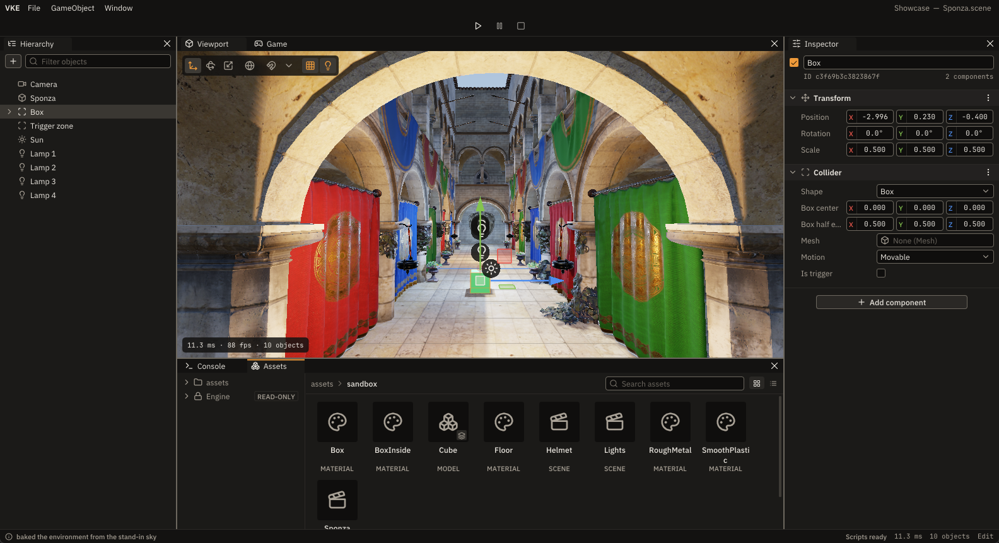
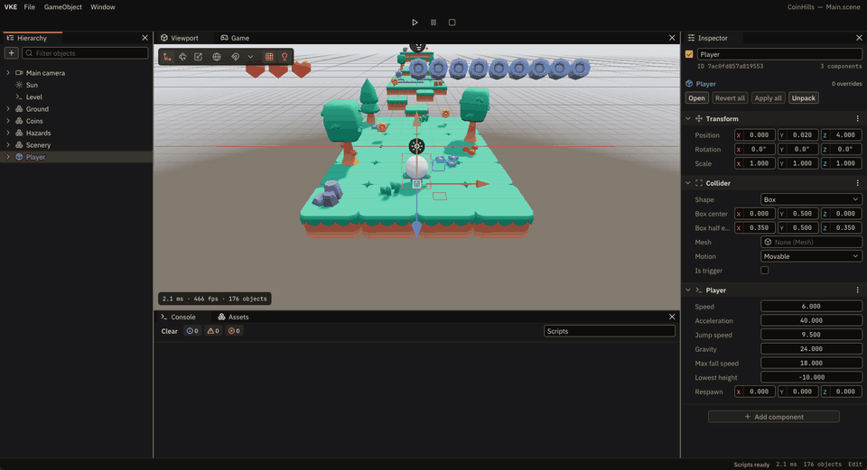
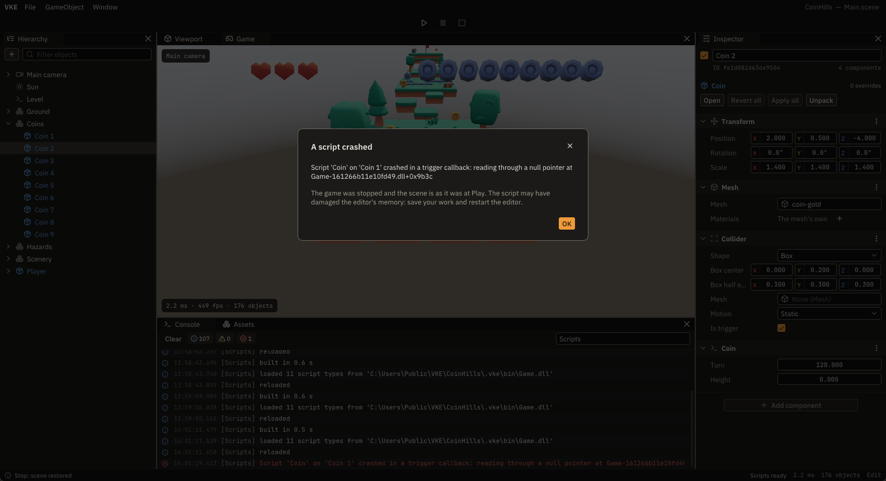
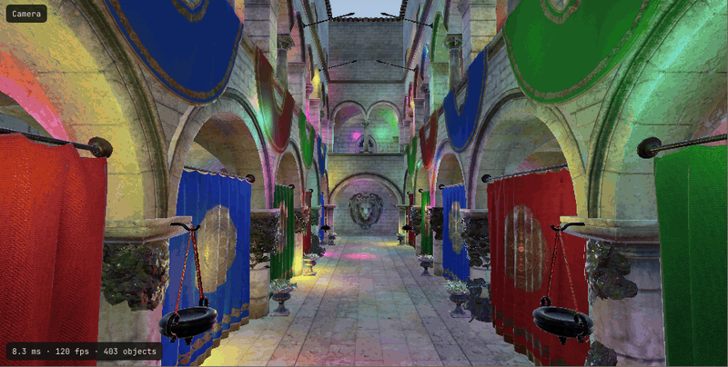
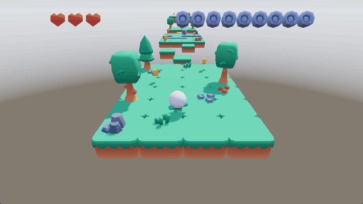
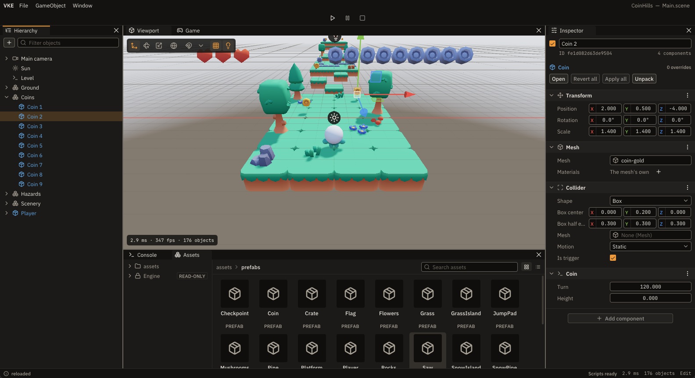

# VKE

VKE is a 3D game engine and editor written from scratch in C++17 on top of Vulkan. It has its own renderer, scene system, collision, asset pipeline and editor, and games are written as C++ scripts that reload while they run.

It began as a single Vulkan application and was rewritten as a set of separate modules. It is a personal project, built to learn how a full engine fits together, from the GPU abstraction up to the tools.



## What it can do

### Change C++ while the game runs

Scripts are plain C++, built into their own DLL against a small SDK. Saving a file while the game runs rebuilds it and swaps the code in. Objects stay where they are, and marked properties keep their values. Below, one line changes how high the character hops: the game doesn't stop, the two coins already taken stay taken, and the build takes 0.7 s.



### Survive a script that crashes

A bad pointer in a script stops the game, not the editor. The editor reports the script, the object and the callback, then puts the scene back the way it was before Play. The same protection covers division by zero, uncaught exceptions and stack overflows.



### Use as many lights as the scene needs

There is no fixed limit on lights or shadows. Lights are sorted into clusters on the CPU, and all shadows share one atlas that gives more room to the lights that matter most from the current view. This is Sponza with 400 moving point lights, 8 of them casting shadows, at about 8 ms a frame in a Debug build. The counter in the corner is the engine's own.



### Build a game and run it outside the editor

CoinHills is a small platformer made to test the whole path. It has 11 scripts written only against the SDK, and here it runs in `Runtime`, the standalone player, with no editor involved.



### Reuse objects with prefabs

An instance stores only what differs from its prefab. A prefab can be edited on its own, and from the Inspector an instance can revert to it, apply its changes to it, or unpack from it.



## Features

- **Rendering:** forward PBR, HDR with tonemapping, image-based lighting, clustered lights, and directional, spot and point shadows in one atlas.
- **Graphics layer:** an RHI that keeps Vulkan behind its own interface, with shaders compiled at build time.
- **Scenes:** game objects with components and a transform hierarchy, saved as YAML, with component properties described by a reflection generator.
- **Collision:** box and mesh colliders, triggers and contact events.
- **Editor:** project hub and templates, Hierarchy, Inspector, Viewport with gizmos and GPU picking, asset browser, material editor, Console, and Play, Pause and Stop.
- **Scripting:** C++ scripts with start, update, collision and trigger callbacks, compiled on save, with build errors in the Console that open at their line.

## Current limits

VKE runs on Windows only for now. It doesn't play skeletal animation yet, has no in-game UI, and has no step to package a finished game.

## Repository layout

| Folder | Contents |
| --- | --- |
| `Engine/` | The engine, one module per folder: `RHI`, `Renderer`, `Scene`, `Physics`, `Assets`, `Scripting`, `UI` and others |
| `Engine/SDK/` | The API that game scripts can see |
| `Editor/` | The editor application |
| `runtime/` | The standalone player |
| `sandbox/` | A small app for testing engine features |
| `tools/` | Build tools, including the reflection generator |

## Building

### 1. Prerequisites

Install the following:

1. **Visual Studio 2022+ / 2026**

2. **Vulkan SDK**
   - Download and install from: https://vulkan.lunarg.com/sdk/home
   - During install, let it:
     - Set the `VULKAN_SDK` environment variable
     - Add Vulkan binaries to `PATH`

3. **vcpkg**
   - Clone vcpkg somewhere on your machine:
     ```bash
     git clone https://github.com/microsoft/vcpkg.git
     ```
   - Bootstrap:
     ```bash
     .\vcpkg\bootstrap-vcpkg.bat
     ```
   - Set `VCPKG_ROOT`:
     ```powershell
     setx VCPKG_ROOT "C:\path\to\vcpkg"
     ```

The repo already contains `vcpkg-configuration.json` and `vcpkg.json`, so dependencies are restored automatically.

### 2. Get the source

```bash
git clone https://github.com/ErickAzevedo7/Vulkan_Engine.git
cd Vulkan_Engine
```

### 3. Install dependencies (vcpkg)

From the repo root:

```bash
.\path\to\vcpkg\vcpkg integrate install
```

Visual Studio uses `vcpkg-configuration.json` and `vcpkg.json` to install the required libraries on the first build. No manual package list is needed.

### 4. Build and run (Visual Studio)

1. Open `Vulkan_Engine` in **Visual Studio**:
   - `File` → `Open` → `Folder...`
   - Visual Studio configures the project from `CMakeLists.txt`. It needs `VCPKG_ROOT` set.

2. Select the configuration: `x64-Debug` or `x64-Release`.

3. Build: `Build` → `Build All`.

4. Run:
   - Select `Editor.exe` as the startup item.
   - Press `F5` to run with the debugger or `Ctrl+F5` to run without it.

## Credits

The Sponza model was created by Frank Meinl at Crytek, based on the original by Marko Dabrovic. The models in CoinHills are from [Kenney's Platformer Kit](https://www.kenney.nl), released under CC0.
